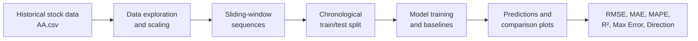

# Stock Market Value Prediction

**Comparative Deep Learning Study | Python · TensorFlow/Keras · Time-Series Analysis**

An academic machine-learning project comparing recurrent neural networks, attention-based architectures, and statistical baselines on historical stock-market data. The study investigates how different sequence models capture market patterns, evaluates their predictions with multiple metrics, and visualizes actual-versus-predicted values.

**Authors:** Sayojya Patil, Jayanth Nama, and Vrunda Kadam  
**Course:** ECE 5831 — Final Project (2025), University of Michigan–Dearborn

## Overview

The experiments use historical stock data (the `AA.csv` dataset linked below) with **Open, High, Low, and Close** columns in the notebook's preprocessing pipeline. The notebook explores different model capacities and lookback windows, compares deep learning methods against simpler approaches, and records visualizations and evaluation metrics.

This repository preserves the original notebook experiments and their saved results. The purpose is **research comparison**, not a live trading system or a verified out-of-sample financial forecasting product.

## Models and Approaches

| Approach | Role in the experiments |
| --- | --- |
| Simple RNN | Basic recurrent sequence model |
| LSTM | Gated recurrent network; includes deeper architectures and varying input windows |
| GRU | Parameter-efficient gated recurrent model |
| Transformer Encoder | Attention-based temporal modeling |
| CNN + BiLSTM + Attention | Convolutional feature extraction with bidirectional recurrence and attention |
| Random Walk | Stochastic comparison baseline implemented in the notebook |
| Over-Regularized Deep LSTM | Experiment examining the effects of heavy regularization |
| SMA, EMA, and moving averages | Additional classical baselines examined earlier in the notebook |

## Experimental Workflow



The notebook includes price plots, training-loss curves, prediction overlays, zoomed-in comparisons, and a final performance table.

## Recorded Results

The following values are **transcribed from the final evaluation table saved in the notebook**. They are not results from a new run. RMSE/MAE are in the notebook's transformed target scale; directional accuracy is a fraction (0–1).

| Model | RMSE ↓ | MAE ↓ | MAPE (%) ↓ | R² ↑ | Directional Accuracy ↑ |
| --- | ---: | ---: | ---: | ---: | ---: |
| Simple RNN | 0.0220 | 0.0161 | 22.3937 | 0.9970 | 0.7303 |
| LSTM | 0.0496 | 0.0452 | 71.8065 | 0.9846 | **0.7774** |
| GRU | **0.0212** | **0.0152** | **19.2040** | **0.9972** | 0.6890 |
| Transformer Encoder | 0.0702 | 0.0497 | 74.0225 | 0.9692 | 0.5425 |
| CNN-BiLSTM-Attention | 0.0299 | 0.0209 | 30.3636 | 0.9944 | 0.6439 |
| Random Walk | 1.7951 | 1.7545 | 2434.2612 | -19.1891 | 0.5063 |
| Over-Regularized Deep LSTM | 0.2644 | 0.2428 | 314.2006 | 0.5619 | 0.4978 |

**Observed comparison:** GRU has the lowest recorded RMSE and MAE in this evaluation, while LSTM has the highest recorded directional accuracy. Results depend on the original experimental setup and are **not evidence of validated future-market forecasting performance**.

### Experimental Limitations

The experiments use the original academic implementation and its recorded evaluation results. Preprocessing was performed before the chronological train/test split, introducing potential data leakage, while prediction targets were aligned with the input window rather than a future trading day.

Consequently, the reported metrics reflect the original comparative experiments rather than validated out-of-sample forecasting performance. The notebook and its recorded results have been preserved for research reproducibility.

## Repository Structure

```text
stock-market-value-prediction/
├── Stock_Market_Value_Prediction.ipynb
├── StockMarketValuePredictionUsingRNN.pdf
└── README.md
```

## Run the Notebook

1. Clone the repository:

   ```bash
   git clone https://github.com/SayojyaPatil/stock-market-value-prediction.git
   cd stock-market-value-prediction
   ```

2. Install Jupyter and the libraries used in the notebook (preferably in a virtual environment):

   ```bash
   python -m pip install jupyter numpy pandas matplotlib scikit-learn tensorflow statsmodels
   ```

3. Download the dataset from the [project dataset link](https://drive.google.com/file/d/1nDnhtlFZCzG_5JPXLz-D3ZQkeQCWJoMw/view?usp=drive_link). Save the CSV as **`AA.csv`** beside the notebook. The dataset is not included in this repository.

4. Start Jupyter **from the repository directory**:

   ```bash
   jupyter notebook Stock_Market_Value_Prediction.ipynb
   ```

5. Run cells in order. Training includes several neural models and may be CPU/GPU intensive. Recomputed results can differ due to random initialization, library versions, and hardware.

**Reproducibility scope:** The only notebook code change in this update replaces a computer-specific CSV path with `AA.csv` in the current working directory. The original model code, experiment parameters, saved outputs, and research PDF are preserved. The full end-to-end notebook has not been rerun in a clean environment as part of this documentation update.

## Research Materials

- **Research paper:** [StockMarketValuePredictionUsingRNN.pdf](StockMarketValuePredictionUsingRNN.pdf)
- **Project notebook:** [Stock_Market_Value_Prediction.ipynb](Stock_Market_Value_Prediction.ipynb)
- **Presentation slides:** [Google Slides](https://docs.google.com/presentation/d/1kK9vDVO_8dv08J55woL6Vu_OkJvodhsg/edit?usp=drive_link&ouid=115378471990167619842&rtpof=true&sd=true)
- **Presentation recording:** [Google Drive](https://drive.google.com/file/d/1qYlFpMUo3ds9hKFlOGwGPn2GzjpGGLAb/view?usp=drive_link)
- **Demo video:** [YouTube](https://youtu.be/BBZOg-26CsI)
- **Dataset:** [AA.csv download link](https://drive.google.com/file/d/1nDnhtlFZCzG_5JPXLz-D3ZQkeQCWJoMw/view?usp=drive_link)
- **Additional project files:** [Google Drive folder](https://drive.google.com/drive/folders/1cmnmyLsZc3yIPTI2TiEQEm0lHSIY9zcJ?usp=drive_link)

---

**Project:** ECE 5831 (2025) — academic research and model comparison, not investment advice.
